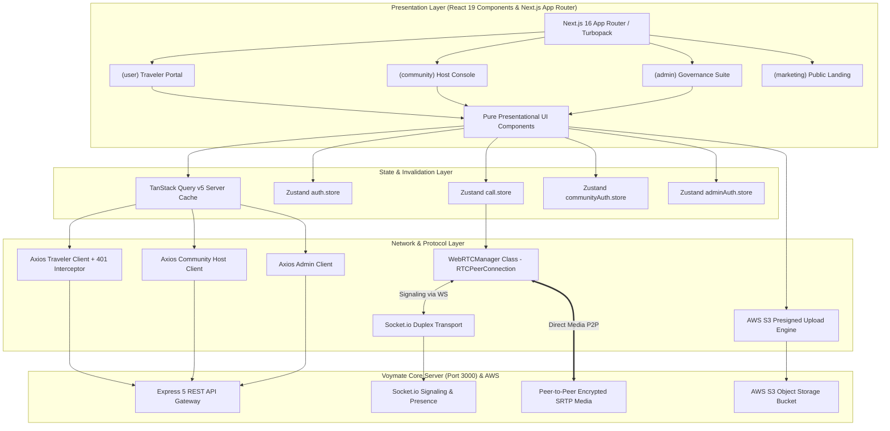
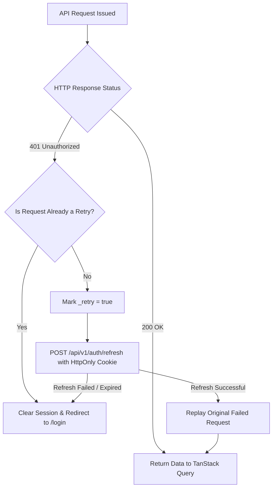

<div align="center">

# 🧭 Voymate Client (`Web Platform`)
### Real-Time Solo Traveler Discovery, WebRTC Video Calling, Community Expeditions & Admin Governance

[-000000?logo=next.js&logoColor=white)](https://nextjs.org/)
[](https://react.dev/)
[](https://www.typescriptlang.org/)
[](https://tailwindcss.com/)
[](https://tanstack.com/query/latest)
[](https://github.com/pmndrs/zustand)
[](https://webrtc.org/)
[](https://socket.io/)
[](https://serwist.pages.dev/)

<p align="center">
  <b>Engineered with Next.js 16 App Router, React 19, Feature-Driven Architecture (Vertical Slices), Pure TypeScript WebRTC State Machine and Edge Cookie Route Interception.</b>
</p>

---

</div>

## 📌 Executive Architectural Summary

The **Voymate Web Client** is an enterprise-grade Single Page Application (SPA) and Progressive Web App (PWA) designed to deliver sub-100ms real-time interactions, smooth geospatial mapping, low-latency WebRTC video calling, and a robust multi-tenant portal experience.

Rather than co-locating business logic inside React components, the application enforces a strict **Feature-Driven Architecture (Vertical Slice)**:
- **Server State**: Managed exclusively through `@tanstack/react-query` v5 (optimistic updates, automatic cache invalidation, window focus re-fetching, pagination).
- **Ephemeral Client State**: Managed through lightweight, decoupled `Zustand` stores (Auth sessions, Active WebRTC media streams, Multi-step onboarding wizards).
- **Real-Time Fabric**: Built on persistent `Socket.io` connections and a decoupled, class-based `WebRTCManager` handling ICE candidate exchanges and media track lifecycles.
- **Resilient Network Layer**: Axios response interceptors handle silent 401 JWT token rotation with automatic replay queues and redirect preservation.

---

## 🏛️ Client Architecture & State Segregation



---

## ⚡ Core Engineering Subsystems

### 1. WebRTC Peer-to-Peer Calling Engine (`WebRTCManager.ts`)
Handling real-time 1-on-1 audio and video calls requires a deterministic state machine free from React render-cycle race conditions.
- **Class-Based Encapsulation**: The native `RTCPeerConnection` instance lives inside a pure TypeScript class (`WebRTCManager`), completely isolated from React re-renders.
- **STUN & Trickle ICE**: Configured with Google public STUN servers (`stun:stun.l.google.com:19302`) with asynchronous ICE candidate streaming via WebSocket.
- **MediaStream Controls**:
  - Hardware camera flip (front/back on mobile).
  - Audio track muting and video track disabling without tearing down the peer connection.
  - Automatic track cleanup upon call termination (`stream.getTracks().forEach(t => t.stop())`).
### 2. Multi-Tenant Route Interception & JWT Token Refresh
The platform supports three distinct user domains across a unified codebase. The client enforces security invariants through Axios response interceptors:



- **Zero-Flicker Token Refresh**: When an access token expires mid-session, pending requests are queued, the token is refreshed silently via HTTP-only cookie, and the original requests are replayed without user interruption.
- **Deep-Link Redirection**: Unauthenticated attempts to access protected routes (`/home`, `/profile`, `/trips`, `/messages`) preserve the target destination via `?redirect=/target/path` for post-login return.

---

### 3. Direct-to-S3 Cloud Upload Pipeline (Zero-Server-Hop)
Uploading multi-photo high-resolution galleries (e.g. 10 photos of 8MB each for an expedition) through an Express server saturates CPU and RAM.
- **Two-Phase Protocol**:
  1. Client sends file metadata (MIME type, byte size, file purpose) to `/api/v1/storage/upload-url`.
  2. Server verifies authentication and returns a time-bounded AWS S3 presigned PUT URL.
  3. Client streams the binary payload directly to S3 via `axios.put(uploadUrl, file, { headers: { 'Content-Type': file.type } })`.
- **Live Progress Monitoring**: Tracks individual and aggregate upload percentage (`onUploadProgress`) with cancelation tokens.

---

### 4. Geospatial Traveler Discovery & Google Maps
- **PostGIS Proximity Integration**: Matches travelers based on real-time coordinates, customizable radius sliders, and "Currently Traveling" activity flags.
- **Map Visualization**: Utilizes `@vis.gl/react-google-maps` with custom SVG map pins, active traveler cards, and interactive cluster coordinates.

---

### 5. Community Host Organizer Console
A dedicated workspace for tour operators, certified trek leaders, and travel communities:
- **Expedition Lifecycle**: Multi-photo gallery uploader, dynamic pricing (Free Camps vs. Razorpay-escrowed Paid Expeditions), itinerary builder, and capacity limits.
- **Roster Management**: Live booking list with attendee contacts, emergency numbers, and check-in pass validation codes (`VM-<SLUG>-<CODE>`).
- **KYC Verification Submission**: Commercial host document uploader (Govt ID, business registration, certificates) with live status tracking.

---

### 6. Admin Telemetry & Moderation Console
A mission-control panel for platform administrators:
- **User Governance**: Searchable, paginated user management table with account blocking/unblocking.
- **Document AI Verification Review**: Side-by-side inspection of uploaded identity documents against AI-extracted fields, fraud risk scores, and confidence badges.
- **Platform Analytics**: Interactive chart visualizations using `recharts` (user registration velocity, trip creation trends, booking volume).

---

## 📂 Project Directory Structure

```
client/
├── src/
│   ├── app/                                 # Next.js 16 App Router (Route Groups)
│   │   ├── (marketing)/                     # Public Landing Page & Feature Showcases
│   │   ├── (auth)/                          # Traveler Login, Signup & OAuth Callbacks
│   │   ├── (onboarding)/                    # Multi-Step Traveler Onboarding Wizard
│   │   ├── (forgot-pass)/                   # Password Recovery Flow
│   │   ├── (verify)/                        # Email / Phone OTP Verification
│   │   ├── (user)/                          # Authenticated Traveler Portal
│   │   │   ├── home/                        # Feed & Buddies on the Road Alerts
│   │   │   ├── matches/                     # Travel Buddy Matchmaking Engine
│   │   │   ├── nearby/                      # PostGIS Proximity Discovery Map
│   │   │   ├── messages/                    # Real-Time Duplex Chat & Video Calls
│   │   │   ├── trips/                       # Itinerary Builder & Trip Planner
│   │   │   ├── community-trips/             # Community Expeditions & Digital Passes
│   │   │   ├── ai-assistant/                # LangGraph Conversational Travel Agent
│   │   │   └── profile/                     # Public & Private Traveler Profiles
│   │   ├── (community)/                     # Community Organizer Workspace
│   │   │   ├── community/login              # Host Authentication Portal
│   │   │   ├── community/onboarding         # Host Brand Setup (Avatar & Cover S3)
│   │   │   └── community/dashboard/         # Console: Metrics, Trips, Rosters, KYC
│   │   └── (admin)/                         # Platform Administration Suite
│   │       ├── admin/login                  # Admin Credentials Entry
│   │       └── admin/dashboard/             # Analytics, User Moderation, KYC Queue
│   │
│   ├── features/                            # Feature-Driven Architecture (Vertical Slices)
│   │   ├── user/                            # Traveler Domain Modules
│   │   │   ├── matches-connections/         # Match Cards, Requests, Proximity Engine
│   │   │   ├── chat/                        # Socket Duplex Chat & Message Bubbles
│   │   │   ├── call/                        # WebRTC Audio & Video Calling Handlers
│   │   │   ├── community-trips/             # Trip Catalog, Pass Modal, Checkout
│   │   │   └── ai-assistant/                # Markdown Streaming & Itinerary Cards
│   │   ├── community/                       # Community Domain Modules
│   │   │   ├── components/organizer/        # Sidebar, Header, Gallery Uploader
│   │   │   ├── pages/organizer/             # Dashboard, Create Trip, Bookings
│   │   │   └── hooks/                       # Community Auth & Trip Mutations
│   │   ├── admin/                           # Admin Domain Modules
│   │   │   └── features/                    # Verification Queue, User Management, Analytics
│   │   └── marketing/                       # Landing Page Hero & Feature Previews
│   │
│   ├── store/                               # Decoupled Zustand Stores
│   │   ├── auth.store.ts                    # Traveler Session & User State
│   │   ├── communityAuth.store.ts           # Community Host Session & Profile State
│   │   ├── adminAuth.store.ts               # Admin Credentials & Permissions State
│   │   └── call.store.ts                    # WebRTC Active Call & Stream State
│   │
│   ├── webRtc/                              # Native WebRTC Abstractions
│   │   └── WebRTCManager.ts                 # Class-Based RTCPeerConnection Controller
│   │
│   ├── socket/                              # WebSocket Event Handlers
│   │   ├── socket.ts                        # Socket.io Client Instance & Reconnect Logic
│   │   ├── chat/chat.socket.ts              # Instant Messaging & Presence Emitters
│   │   └── call/call.socket.ts              # WebRTC Signaling Emitters & Listeners
│   │
│   ├── lib/                                 # Network Clients & Interceptors
│   │   ├── api-client.ts                    # Traveler Axios Client (Token Rotation)
│   │   ├── community-api.ts                 # Community Host Axios Client
│   │   └── admin-api.ts                     # Admin Axios Client
│   │
│   └── proxy.ts                             # Next.js Route Protection & Session Gating
│
├── public/                                  # Static Assets, PWA Icons & Manifest
├── package.json                             # Dependencies & Scripts
├── tsconfig.json                            # Strict TypeScript Compiler Config
└── next.config.ts                           # Next.js Build & Image Optimizations
```

---

## 🛠️ Technology Stack & Tooling

| Domain | Technology / Library | Architectural Role |
| :--- | :--- | :--- |
| **Framework** | Next.js 16 (App Router + Turbopack) | Server/Client components, route grouping, streaming |
| **Language** | TypeScript (v5.x Strict) | Type safety across DTOs, stores, and UI props |
| **UI Library** | React 19 | Concurrency, actions, optimized hooks |
| **Server State** | TanStack React Query v5 | Data caching, background refetching, mutations |
| **Client State** | Zustand v5 | Lightweight atomic state stores (Auth, WebRTC, Host) |
| **Styling** | Tailwind CSS v4 | Zero-runtime CSS utility classes |
| **Animations** | Framer Motion (`motion`) | Declarative layout animations, presence modals |
| **Real-Time** | Socket.io Client 4.x | Duplex WebSocket messaging & WebRTC signaling |
| **Video / Audio** | Native `RTCPeerConnection` (WebRTC) | Peer-to-peer encrypted media streams (SRTP) |
| **Geospatial** | `@vis.gl/react-google-maps` | Google Maps rendering & marker synchronization |
| **Forms & Validation** | React Hook Form + Zod | Controlled zero-overhead forms with schema assertions |
| **Data Viz** | Recharts | Platform metrics, user growth, booking histograms |
| **PWA** | Serwist (`@serwist/next`) | Service worker caching, offline capability |
| **Notifications** | Sonner | High-performance toast alerts |

---

## 🚀 Getting Started (Local Development)

### 1. Prerequisites
- **Node.js**: `v20.x` or higher
- **Backend API**: Voymate Server running on `http://localhost:3000`

### 2. Installation & Development Server
```bash
# Install dependencies
npm install

# Start Next.js development server with Turbopack acceleration
npm run dev

# Open http://localhost:3001 in your browser
```

### 3. Production Build & Linting
```bash
# Verify TypeScript strict compilation across all modules
npm run build

# Run Next.js and ESLint code quality checks
npm run lint
```

---

## 👨‍💻 Engineering Philosophy & Takeaways

> *"A world-class frontend is not just about aesthetic UI design. It is defined by its resilience against network failures, deterministic real-time state management, clean component decoupling, and uncompromised performance under heavy data streaming."*

This client application demonstrates software engineering rigor:
- **Separation of Concerns**: UI components render view logic; TanStack Query handles server synchronization; Zustand manages client state; and pure TypeScript classes govern WebRTC connections.
- **Defensive Error Boundaries**: Automatic 401 token refresh prevents annoying mid-session logouts, ensuring an uninterrupted journey for travelers and hosts alike.

---

<div align="center">
  <sub>Engineered with precision for Voymate. Designed for scale, beauty, and real-time human connection.</sub>
</div>
