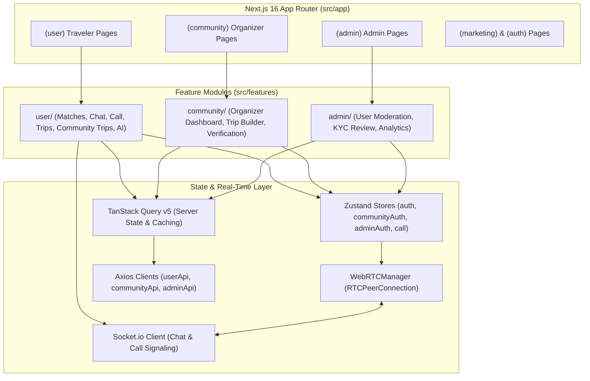
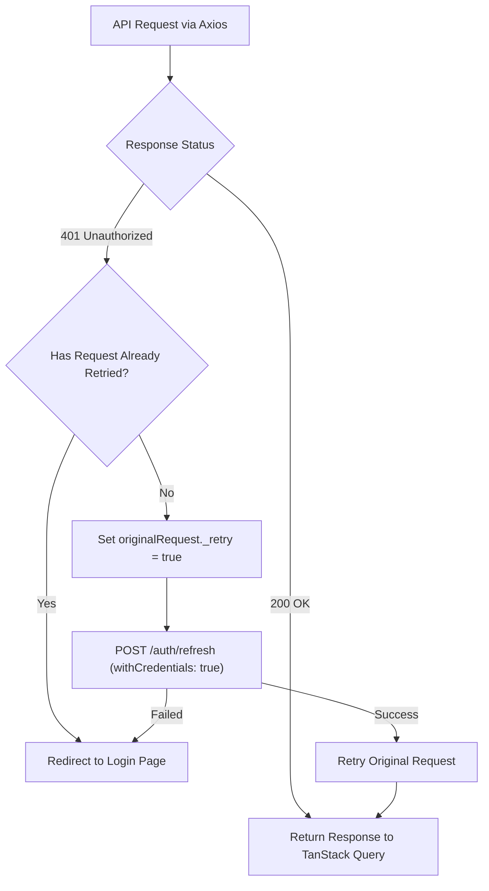

# Voymate Client

### Next.js Frontend for Traveler Matchmaking, Real-Time Chat/Calls & Community Trips

[-000000?logo=next.js&logoColor=white)](https://nextjs.org/)
[](https://react.dev/)
[](https://www.typescriptlang.org/)
[](https://tailwindcss.com/)
[](https://tanstack.com/query/latest)
[](https://github.com/pmndrs/zustand)
[](https://webrtc.org/)
[](https://socket.io/)

---

## Overview

**Voymate Client** is the Next.js 16 web application for Voymate. It provides three role-based portals within a single codebase:
1. **Traveler Portal (`(user)`)**: Create trip plans, get matched with compatible solo travelers, discover nearby travelers on Google Maps, chat and make 1-on-1 audio/video calls, use the AI travel assistant, and book community trips.
2. **Community Organizer Portal (`(community)`)**: Onboard travel clubs/organizers, submit verification documents, create free or paid group trips, and manage participant bookings.
3. **Admin Dashboard (`(admin)`)**: Review user and community KYC verification submissions with OCR-extracted details, manage user accounts, and view platform analytics.

The codebase is organized by feature modules (`src/features/`) with **TanStack Query v5** handling API caching and mutations, and **Zustand v5** managing client-side auth and active call state.

---

## Client Architecture



---

## Key Features & Implementation

### 1. Peer-to-Peer Audio & Video Calling (`WebRTCManager.ts`)

Instead of tying `RTCPeerConnection` directly to React component state, WebRTC connections are managed through a dedicated `WebRTCManager` TypeScript class (`src/webRtc/WebRTCManager.ts`):
- **Connection Setup**: Configures `RTCPeerConnection` with Google STUN (`stun:stun.l.google.com:19302`) and handles local media capture via `navigator.mediaDevices.getUserMedia`.
- **Signaling over Socket.io**: Exchanges SDP offers (`call:offer`), answers (`call:answer`), and ICE candidates (`call:ice-candidate`) through `src/socket/call/call.socket.ts`.
- **Stream Lifecycle & Controls**: Supports toggling microphone and camera tracks during an active call and stops all media tracks (`track.stop()`) and closes the peer connection on hangup.

---

### 2. Multi-Portal Authentication & Axios Token Refresh

Each portal (`Traveler`, `Community Organizer`, `Admin`) uses its own dedicated Axios instance (`userApi`, `communityApi`, `adminApi`) and Zustand store:



- **Automatic Token Refresh**: When an access token expires and returns `401`, the Axios response interceptor calls the refresh endpoint using the `HttpOnly` refresh cookie and retries the original request automatically.
- **Route Protection (`src/proxy.ts`)**: Checks authentication cookies for protected user and admin routes and redirects unauthenticated visitors to `/login?redirect=<path>`.

---

### 3. Geospatial Nearby Traveler Map & Matchmaking

- **Nearby Travelers Map**: Uses `@vis.gl/react-google-maps` to render interactive maps showing active travelers within a selected kilometer radius, powered by the backend's PostGIS spatial queries.
- **Trip Companion Matching**: Travelers create upcoming trips with dates, destination, budget, and travel style, and browse ranked companion matches with compatibility breakdowns and connection requests.

---

### 4. Community Trips & Razorpay Checkout

- **Traveler Booking Flow**: Users can browse verified community trips, view day-by-day itineraries, join free trips directly, or book paid trips through the integrated **Razorpay** checkout modal.
- **Organizer Workspace**: Community hosts can register, verify their email via OTP, upload verification certificates, create new trips with multi-image galleries, and view booked participant rosters.

---

### 5. Multi-Step KYC Verification & Admin Review

- **Document Upload Wizard**: Step-by-step modal (`DocumentUploadModal.tsx`) for selecting document type (Passport, Aadhaar, Driving License), uploading front/back images via `FormData`, and tracking verification status.
- **Admin Verification Queue**: Admins can inspect uploaded documents alongside the fields extracted by Google Document AI and the calculated risk score before approving, rejecting, or requesting resubmission.

---

## Project Structure

```
client/
├── src/
│   ├── app/                                 # Next.js 16 App Router
│   │   ├── (marketing)/                     # Landing page
│   │   ├── (auth)/                          # Traveler login & signup
│   │   ├── (onboarding)/                    # Traveler profile onboarding
│   │   ├── (forgot-pass)/                   # Password reset flow
│   │   ├── (verify)/                        # Email & phone OTP verification
│   │   ├── (user)/                          # Traveler portal (home, matches, nearby, messages, trips, ai-assistant, community-trips, profile)
│   │   ├── (community)/                     # Community organizer portal (login, onboarding, dashboard)
│   │   └── (admin)/                         # Admin portal (login, dashboard, users, verifications)
│   │
│   ├── features/                            # Feature modules (components, hooks, services, types)
│   │   ├── user/                            # Traveler features
│   │   ├── community/                       # Community organizer features
│   │   ├── admin/                           # Admin dashboard features
│   │   └── marketing/                       # Landing page sections
│   │
│   ├── store/                               # Zustand state stores
│   │   ├── auth.store.ts                    # Traveler auth store
│   │   ├── communityAuth.store.ts           # Community organizer auth store
│   │   ├── adminAuth.store.ts               # Admin auth store
│   │   └── call.store.ts                    # WebRTC call state store
│   │
│   ├── webRtc/
│   │   └── WebRTCManager.ts                 # RTCPeerConnection wrapper class
│   │
│   ├── socket/                              # Socket.io client & event handlers
│   │   ├── socket.ts
│   │   ├── chat/chat.socket.ts
│   │   └── call/call.socket.ts
│   │
│   ├── lib/                                 # Axios instances & interceptors
│   │   ├── api-client.ts
│   │   ├── community-api.ts
│   │   └── admin-api.ts
│   │
│   └── proxy.ts                             # Route protection middleware
│
├── public/                                  # Static assets & PWA icons
├── package.json
├── tsconfig.json
└── next.config.ts
```

---

## Tech Stack

| Category | Technology | Purpose |
| :--- | :--- | :--- |
| **Framework** | Next.js 16 (App Router) | Routing, layouts, and build tooling |
| **UI Library** | React 19, TypeScript 5 | Component architecture and static typing |
| **Styling & Motion** | Tailwind CSS v4, Framer Motion | Utility styling and UI transitions |
| **Server State** | TanStack React Query v5 | Data fetching, caching, and mutations |
| **Client State** | Zustand v5 | Auth sessions and active call state |
| **Real-Time & Calls** | Socket.io Client, WebRTC | Instant messaging, presence, and P2P audio/video calls |
| **Maps** | `@vis.gl/react-google-maps` | Interactive nearby traveler map |
| **Forms & Validation** | React Hook Form, Zod | Form state and schema validation |
| **Charts** | Recharts | Admin analytics charts |
| **PWA** | Serwist (`@serwist/next`) | Progressive Web App support |

---

## Local Development Setup

### 1. Prerequisites
- Node.js `v20.x` or `v22.x`
- Voymate Server running locally

### 2. Install & Run
```bash
# Install dependencies
npm install

# Start development server
npm run dev
```

### 3. Build & Lint
```bash
# Create production build
npm run build

# Run ESLint
npm run lint
```
